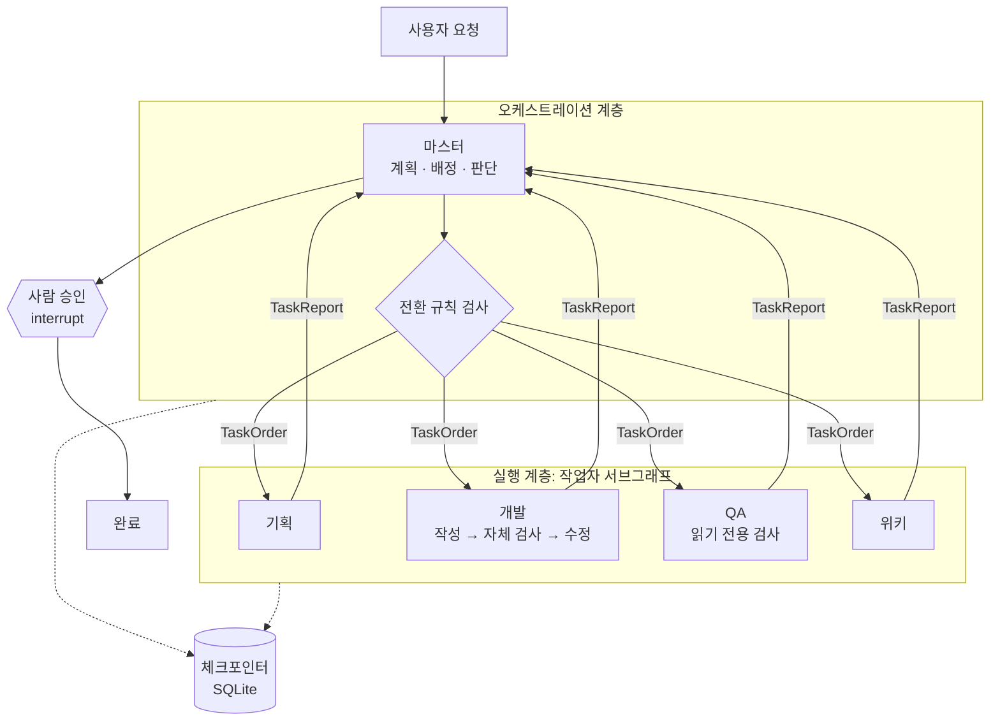

# langgraph-study

LangGraph 기반 **멀티 에이전트 오케스트레이션**을 8주 동안 학습하고 구현하는 저장소입니다.

오케스트레이터(마스터)가 역할별 작업자 에이전트를 지휘하는 Orchestrator-Worker 구조를 만들고,
구현과 검수를 서로 다른 회사의 모델에 맡기는 교차 검수(cross-model review) 파이프라인을 완성하는 것이 목표입니다.

- 기간: 2026.11.16 ~ 2027.01.10 (8주)
- 아래 아키텍처는 구현 목표이며, 진행 상황은 [로드맵](#로드맵)에서 확인할 수 있습니다.

## 왜 그래프인가

에이전트에게 "다음에 무엇을 할지"를 통째로 맡기는 단일 루프 방식은 단계가 늘어날수록 예측과 디버깅이 어려워집니다.
이 프로젝트는 제어 흐름을 그래프로 명시하고, LLM은 각 노드 안의 판단만 맡도록 범위를 좁힙니다.

|                | 단일 에이전트 루프        | 그래프 오케스트레이션            |
| -------------- | ------------------------- | -------------------------------- |
| 다음 단계 결정 | 모델이 매번 자유롭게 결정 | 엣지로 허용된 전환 안에서만 결정 |
| 규칙 준수      | 프롬프트로 부탁           | 코드로 강제                      |
| 실패 복구      | 처음부터 재실행           | 체크포인트에서 재개              |
| 디버깅         | 긴 대화 기록을 추적       | 노드 단위 입출력 추적            |

## 아키텍처

Orchestrator-Worker(Supervisor) 패턴입니다. 2계층으로 구성됩니다.

- **오케스트레이션 계층:** 마스터가 작업자의 보고서를 받아 다음 행동을 결정합니다. 직접 실행은 하지 않습니다.
- **실행 계층:** 각 작업자는 독립된 서브그래프입니다. 내부에서 생성, 자체 검사, 수정을 반복하고 표준 보고서만 위로 올립니다.



## 설계 원칙

### 1. 제어 흐름은 프롬프트가 아니라 구조로 강제한다

마스터는 LLM이지만, 마스터가 고를 수 있는 전환은 코드가 제한합니다.
"QA를 통과하지 않으면 위키로 갈 수 없다", "재시도는 최대 2회" 같은 불변 조건(invariant)은 라우팅 함수와 가드에서 검사합니다.

### 2. 에이전트 사이의 계약을 타입으로 고정한다

노드 사이에는 자유 문자열이 아니라 스키마 객체만 오갑니다. 마스터는 지시서(`TaskOrder`)를 내리고 작업자는 보고서(`TaskReport`)로 답합니다.
입출력 형식이 같으므로 작업자를 추가하거나 교체해도 마스터는 바뀌지 않습니다.

### 3. 생성과 검증을 분리한다

구현은 Claude, 검수는 GPT가 맡습니다. 같은 모델이 만들고 검사하면 같은 맹점을 공유하기 때문입니다.
검수자에게는 구현 과정의 추론을 넘기지 않고 변경된 코드와 완료 조건만 넘깁니다. QA는 읽기 전용으로 실행하며, 실행 전후 `git diff`를 비교해 소스가 바뀌었으면 결과를 무효로 처리합니다.

### 4. 실패는 예외가 아니라 데이터로 다룬다

타임아웃이나 오류가 나도 그래프를 멈추지 않습니다. 작업자는 `status="failed"` 보고서를 올리고, 재시도할지 재계획할지는 마스터가 결정합니다.
작은 실패는 작업자 내부의 수정 루프에서, 큰 실패는 오케스트레이션 계층에서 처리합니다.

### 5. 실행은 중단과 재개가 가능해야 한다

모든 단계의 상태를 체크포인터에 저장합니다. 프로세스가 종료되어도 같은 `thread_id`로 중단 지점부터 재개합니다.
재개 시 중단된 노드는 처음부터 다시 실행되므로, 부작용이 있는 노드는 멱등(idempotent)하게 작성합니다.

### 6. 되돌릴 수 없는 결정은 사람이 승인한다

계획 확정과 최종 결과 반영 전에는 `interrupt()`로 실행을 멈추고 사람의 승인을 기다립니다(human-in-the-loop).
승인 응답도 스키마로 검증합니다.

## 핵심 스키마

```python
from typing import Literal
from pydantic import BaseModel


class TaskOrder(BaseModel):
    """마스터 → 작업자 지시서"""
    goal: str                 # 무엇을 할지
    inputs: list[str]         # 참고할 산출물 경로
    done_when: list[str]      # 완료 조건 (QA의 검사 기준)
    constraints: list[str]    # 하면 안 되는 것


class TaskReport(BaseModel):
    """작업자 → 마스터 보고서"""
    status: Literal["success", "failed"]
    artifacts: list[str]      # 산출물 경로
    issues: list[str]         # 발견한 문제, 실패 원인


class MasterDecision(BaseModel):
    """마스터의 판단 결과. 라우팅은 action 값만 보고 결정한다."""
    action: Literal["dispatch", "retry", "replan", "ask_human", "finish"]
    target_task: str | None
    reason: str               # 판단 근거 (트레이싱용)
```

| action      | 의미                        | 조건                                         |
| ----------- | --------------------------- | -------------------------------------------- |
| `dispatch`  | 다음 작업을 작업자에게 배정 | 직전 작업이 성공                             |
| `retry`     | 같은 작업을 다시 지시       | 구현 수준의 실패, 재시도 상한 이내           |
| `replan`    | 할 일 목록을 수정           | 요구사항 수준의 실패, 전체 작업 수 상한 이내 |
| `ask_human` | 실행을 멈추고 사람에게 질문 | 요청이 모호하거나 상한 초과                  |
| `finish`    | 종료                        | 모든 작업 완료와 승인                        |

## 역할과 권한

| 역할   | 책임                                    | 모델 (5주차 이후) | 도구 권한               |
| ------ | --------------------------------------- | ----------------- | ----------------------- |
| 마스터 | 계획, 배정, 보고서 검토, 다음 행동 결정 | Claude Opus       | 없음 (판단만)           |
| 기획   | 요구사항과 완료 조건 정리               | Claude            | 읽기                    |
| 개발   | 코드 작성, 자체 검사, 수정              | Claude Sonnet     | 읽기, 쓰기, 테스트 실행 |
| QA     | 완료 조건 기준 검사                     | GPT (Codex)       | 읽기, 테스트 실행       |
| 위키   | 결정 사항과 결과 문서화                 | 미정              | 문서 폴더 쓰기          |

1개월차에는 작업자를 가짜 함수와 로컬 모델로 구현해 그래프 구조부터 검증하고, 2개월차에 실제 모델(`claude -p`, `codex exec`)로 교체합니다.

## 요구사항과 LangGraph 기능

| 요구사항                       | LangGraph 기능                                          | 주차 |
| ------------------------------ | ------------------------------------------------------- | ---- |
| 공유 상태와 누적 로그          | `StateGraph`, 리듀서(`Annotated[list, operator.add]`)   | 1    |
| QA 실패 시 되돌림, 재시도 상한 | `add_conditional_edges`                                 | 1    |
| 정해진 값만 반환하는 판단      | `with_structured_output`                                | 2    |
| 중단 후 재개                   | 체크포인터, `thread_id`                                 | 3    |
| 사람 승인                      | `interrupt()`, `Command(resume=...)`, `response_schema` | 3    |
| 작업자 분리                    | 서브그래프                                              | 4    |
| 타임아웃과 실패 보고           | `RetryPolicy`, `timeout`, `error_handler`               | 4    |
| 마스터의 동적 라우팅           | `Command(goto=...)`                                     | 4    |
| 실행 추적                      | LangSmith 트레이싱                                      | 5    |

## 로드맵

### 1개월차: 그래프 기초부터 오케스트레이터 뼈대까지

- [ ] **1주차 (11/16 ~ 11/22)** 환경 세팅, 첫 그래프, 조건 분기
- [ ] **2주차 (11/23 ~ 11/29)** 지시서·보고서 스키마, 첫 LLM 노드
- [ ] **3주차 (11/30 ~ 12/6)** 체크포인트로 중단·재개, 사람 승인
- [ ] **4주차 (12/7 ~ 12/13)** 서브그래프, 실패 처리, 마스터 판단 노드

### 2개월차: 실제 모델로 교체

- [ ] **5주차 (12/14 ~ 12/20)** `claude -p`, `codex exec` 래퍼와 트레이싱
- [ ] **6주차 (12/21 ~ 12/27)** 실제 개발·QA 노드, 교차 검수 루프
- [ ] **7주차 (12/28 ~ 1/3)** 마스터 교체와 전체 실행
- [ ] **8주차 (1/4 ~ 1/10)** 튜닝 마무리와 정리

### 검증 시나리오

최종 시스템은 아래 세 요청이 기대한 경로로 끝나야 합니다.

1. 정상 요청: 기획 → 개발 → QA 통과 → 승인 → 위키
2. QA 1회 실패: 개발 → QA 실패 → 재개발 → QA 통과
3. 모호한 요청: 마스터가 `ask_human`으로 멈추고 질문

## 환경

- Python 3.12
- [uv](https://docs.astral.sh/uv/)
- `langgraph==1.2.*`

```bash
git clone https://github.com/Ourumo/langgraph-study.git
cd langgraph-study
uv sync
uv run python -c "from importlib.metadata import version; print(version('langgraph'))"
```

## 폴더 구조

```
langgraph-study/
├── week01/          # 주차별 실습 코드
├── week02/
├── ...
├── notes/           # 주간 회고, 개념 메모
├── pyproject.toml
└── README.md
```

## 용어

| 용어                                | 설명                                                             |
| ----------------------------------- | ---------------------------------------------------------------- |
| 오케스트레이션                      | 여러 에이전트의 실행 순서, 분기, 실패 처리를 조율하는 일         |
| 오케스트레이터 (마스터, 슈퍼바이저) | 작업을 배정하고 결과를 보고 다음 행동을 정하는 에이전트          |
| 작업자 (워커)                       | 한 가지 역할만 맡아 지시서를 수행하는 에이전트                   |
| 상태 (State)                        | 그래프의 모든 노드가 읽고 쓰는 공유 데이터                       |
| 노드 (Node)                         | 상태를 받아 변경분을 반환하는 실행 단위                          |
| 엣지 (Edge)                         | 노드 사이에 허용된 전환. 조건부 엣지는 상태에 따라 경로를 고른다 |
| 체크포인트                          | 단계마다 저장되는 상태 스냅샷. 재개와 이력 조회의 기반           |
| HITL                                | Human-in-the-loop. 실행 중간에 사람의 판단을 받는 구조           |

## 참고 자료

- [LangChain Academy](https://academy.langchain.com/) - Quickstart: LangGraph Essentials, Introduction to LangGraph
- [LangChain 공식 문서](https://docs.langchain.com)
- [langgraph-101](https://github.com/langchain-ai/langgraph-101) - 공식 예제 노트북
- [LangChain Python 변경 이력](https://docs.langchain.com/oss/python/releases/changelog)
